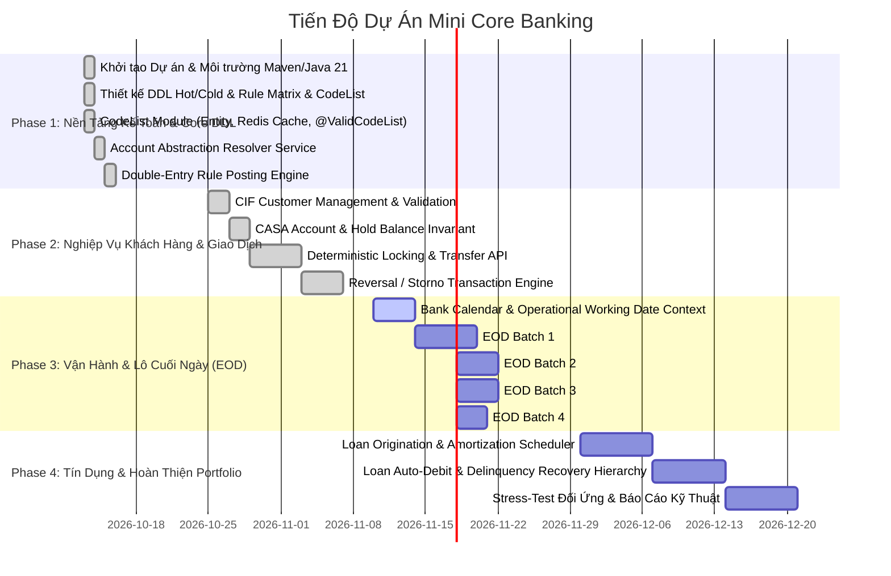

# Core Banking Project - Progress Tracking & Roadmap (`PROJECT_TRACKING.md`)

> **Mục tiêu**: Xây dựng Mini Core Banking Engine (Java 21, Spring Boot 3, Oracle Database)  
> **Thời gian dự kiến**: 2–3 tháng (10–12 tuần)  
> **Trọng tâm**: Tính đúng đắn của nghiệp vụ ngân hàng & Thiết kế CSDL chuyên sâu  
> **Ngày cập nhật gần nhất**: 2026-10-13

---

## 1. Tổng Quan Tiến Độ Các Giai Đoạn (Milestone Progress)

---

## 2. Chi Tiết Danh Mục Công Việc (Task Checklist)

### Giai Đoạn 1: Nền Tảng Kiến Trúc & Kế Toán Kép (Tuần 1 – 3)
- [x] **Setup & Cấu hình môi trường**:
  - [x] Khởi tạo dự án Spring Boot 3.3.4, Java 21, Spring Modulith, Oracle JDBC 23, Flyway.
  - [x] Cấu hình truststore SSL cho Maven và tạo Maven Wrapper `mvnw.cmd`.
  - [x] Xây dựng bộ quy tắc kiến trúc `.agents/` (`AGENTS.md`, `WORKFLOW.md`, `DATABASE_STANDARDS.md`, `CODING_STANDARDS.md`, `ACCOUNTING_DOMAIN.md`, `TESTING_STRATEGY.md`).
- [x] **Thiết kế Cơ sở Dữ liệu (Oracle DDL Migrations)**:
  - [x] `V1__init_core_banking_schema.sql`: Kiến trúc Hot/Cold, CodeList, Chart of Accounts, Account Mappings, Posting Rule Matrix, Balance Buckets.
  - [x] `V2__seed_accounting_rules_and_coa.sql`: Seed danh mục COA, CodeList values, Mappings, Quy tắc định khoản mẫu.
- [x] **Module Quản Lý Danh Mục Mã Động (`CodeList`)**:
  - [x] Entity JPA: `CodeList` và `CodeListValue` (Composite PK `@Embeddable` `CodeListValueId`).
  - [x] Distributed Redis Cache Service: Tra cứu danh mục mã tốc độ cao qua Redis (`cbs:codelist:{group}`).
  - [x] Custom Jakarta Validation: `@ValidCodeList(group = "...")` cho các DTO/Record.
  - [x] Unit Test & Integration Test kiểm tra xác thực trạng thái (11/11 tests pass).
- [x] **Tầng Phân Giải Tài Khoản (`AccountResolverService`)**:
  - [x] Entity JPA: `GlAccount`, `AccountMapping` & `AccountMappingDetail` (sequence `CBS_GLOBAL_SEQ`).
  - [x] Thuật toán Resolver phân giải `SYS_CASH_VAULT` $\rightarrow$ GL vật lý theo Branch, Currency, Product.
  - [x] Fallback logic đa cấp: Cụ thể $\rightarrow$ `product = ALL` $\rightarrow$ `branch = ALL` $\rightarrow$ `ALL, ALL, ALL`.
  - [x] Redis Caching cho kết quả phân giải tài khoản (`cbs:acctmap:...`) với DB fallback & Unit/Integration test (20/20 tests pass).
- [x] **Động Cơ Định Khoản Kế Toán (`PostingEngine`)**:
  - [x] Entity: `AccountingRuleDefinition` mapping bảng `ACCOUNTING_RULE_DEFINITION`.
  - [x] Bộ thông dịch Rule Matrix: Đọc quy tắc động, gán số tiền (`amount_source`), phân giải GL (`AccountResolverService`) và sinh `JournalLeg`.
  - [x] Bỏ qua chân phí khi `feeAmount == 0` (`requires_fee = 'Y'`).
  - [x] Bộ kiểm tra cân bằng đối ứng (Invariant 1): Chặn đứng và ném `UnbalancedTransactionException` nếu $\sum \text{Debit} \ne \sum \text{Credit}$ theo Group và toàn giao dịch.
  - [x] Unit Test & Integration Test kiểm tra định khoản mẫu (`CASH_DEP`, `CASH_WDR`, `TRF_INTERNAL`) thành công 30/30 tests.

---

### Giai Đoạn 2: Khách Hàng, Tài Khoản & Giao Dịch Chống Deadlock (Tuần 4 – 6)
- [x] **Khách hàng (Customer / CIF)**:
  - [x] Quản lý hồ sơ CIF (Individual / Corporate) với mã CIF sinh tự động (`CIF-` + sequence `CBS_GLOBAL_SEQ`).
  - [x] Ràng buộc duy nhất `national_id` (CCCD/Passport) và `cif_number`, chống tạo trùng lặp.
  - [x] Xác thực KYC và trạng thái qua `@ValidCodeList` (`CUST_TYPE`, `KYC_STATUS`, `CUST_STATUS`).
  - [x] Tích hợp `WorkingDateService` (Invariant 4: lấy ngày hệ thống từ `SYSTEM_OPERATIONAL_STATUS`).
- [x] **Tài khoản Tiền gửi (CASA & Holds)**:
  - [x] Mở tài khoản thanh toán `ACCOUNT` liên kết với `PRODUCT_CATALOG` (`CASA_VND`) và GL Control Account (`4211`).
  - [x] Sinh số tài khoản chuẩn BBAN 16 chữ số (`Branch + Product + Sequence`).
  - [x] Quản lý Tạm giữ / Phong tỏa (`ACCOUNT_HOLD`): Thực thi bất biến $\text{Available} = \text{Ledger} - \text{Hold}$ (Invariant 2).
  - [x] Chặn đứng đặt Hold vượt số dư khả dụng bằng `InsufficientFundsException`.
  - [x] Giải phóng Hold (`RELEASED`), cập nhật `released_at`, khôi phục số dư khả dụng và tuân thủ ràng buộc CSDL `chk_hold_status_dates`.
  - [x] Unit Test & Integration Test đầu-cuối Customer + Account + Hold thành công (38/38 tests pass).
- [x] **Giao dịch Chuyển tiền & Chống Deadlock (Transfer API)**:
  - [x] Khóa bi quan có thứ tự tăng dần theo `account_id` (`ORDER BY account_id ASC FOR UPDATE`).
  - [x] Kiểm tra tính duy nhất Composite Idempotency `(channel_id, idempotency_key)` 3 cấp (Redis L1 $\rightarrow$ Hot `TRX_JOURNAL_ACTIVE` $\rightarrow$ Cold `TRX_JOURNAL_DONE`).
  - [x] Early Claim: Chèn header trạng thái `IN_FLIGHT` trước để chốt idempotency và cấp `trx_id`, ghi các dòng `JOURNAL_ENTRY_ACTIVE`, cập nhật số dư khả dụng/sổ cái, kết thúc cập nhật `COMPLETED`.
  - [x] Khắc phục triệt để lỗi Hibernate `ObjectOptimisticLockingFailureException` khi locking bi quan bằng phương thức tra cứu scalar ID `findIdByAccountNumber`.
  - [x] Concurrency stress test 50 giao dịch đối ứng song song ($A \rightarrow B$ và $B \rightarrow A$) đạt 0 deadlock (ORA-00060) và bảo toàn 100% tổng số dư hệ thống.
  - [x] Toàn bộ 51/51 automated tests chạy thành công (`BUILD SUCCESS`).
- [x] **Động cơ Đảo Bút Toán (Reversal / Storno Engine)**:
  - [x] Sinh giao dịch đảo với `original_trx_id` và `reversal_reason`.
  - [x] Sinh các chân bút toán đảo ngược đối xứng hoàn toàn (`D` -> `C`, `C` -> `D`), đánh dấu `is_reversed = 'Y'` ở giao dịch gốc.
  - [x] Kiểm soát ngăn chặn đảo 2 lần (`TransactionAlreadyReversedException`) và không cho đảo giao dịch đảo (`CannotReverseReversalException`).
  - [x] Bất biến 2 Guard: Kiểm tra số dư khả dụng bên bị trích thu hồi (`InsufficientFundsException`).
  - [x] Bất biến 3 Guard: Khóa bi quan có thứ tự tăng dần theo `account_id` trên các tài khoản liên quan (`ORDER BY account_id ASC FOR UPDATE`).
  - [x] Bất biến 4 Guard: Chặn đảo bút toán khi hệ thống đang Cutoff và chỉ cho phép Storno trong ngày (`ReversalWorkingDateMismatchException`).
  - [x] Test đơn vị và test tích hợp đầu cuối & concurrency race test thành công (63/63 tests pass).

---

### Giai Đoạn 3: Vận Hành Ngân Hàng & Chạy Lô Cuối Ngày (EOD) (Tuần 7 – 9)
- [ ] **Ngữ Cảnh Ngày Làm Việc (Bank Working Date Context)**:
  - [ ] Tách rời hoàn toàn khỏi đồng hồ vật lý `LocalDate.now()`.
  - [ ] Interceptor chặn giao dịch nếu cờ `is_system_cutoff = 'Y'`.
- [ ] **Spring Batch Pipeline EOD**:
  - [ ] Step 1: Cắt sổ giao dịch ban ngày (`Cut-off`).
  - [ ] Step 2: Tính lãi dồn tích hàng ngày cho tài khoản tiết kiệm/thanh toán theo công thức chuẩn (`Actual/365`).
  - [ ] Step 3: Chụp ảnh số dư đóng sổ vào `ACCOUNT_BALANCE_BUCKET`.
  - [ ] Step 4: Di chuyển dữ liệu đã hoàn tất từ bảng Hot sang bảng Cold (`MoveDataHisTask`).
  - [ ] Step 5: Thẩm định Cân đối Kế toán Toàn hàng (Trial Balance Balancing Check).
  - [ ] Step 6: Chuyển ngày làm việc sang ngày làm việc tiếp theo trong `BANK_CALENDAR`.

---

### Giai Đoạn 4: Module Tín Dụng & Hoàn Thiện Portfolio (Tuần 10 – 12)
- [ ] **Hợp Đồng Vay & Lập Lịch Trả Nợ (Loan Amortization)**:
  - [ ] Lập lịch trả nợ Gốc đều (Equal Principal) và Niên kim cố định (Annuity / EMI) bằng `BigDecimal` chuẩn xác.
  - [ ] Giải ngân vào tài khoản CASA của khách hàng thông qua Rule Matrix.
- [ ] **Thu Nợ Tự Động & Phân Bổ Quá Hạn**:
  - [ ] Tự động trích nợ từ CASA trong EOD batch.
  - [ ] Phân bổ thứ tự thu hồi nợ: Phí $\rightarrow$ Phạt quá hạn $\rightarrow$ Lãi quá hạn $\rightarrow$ Gốc quá hạn.
- [ ] **Kiểm Thử Hiệu Năng & Tài Liệu Portfolio**:
  - [ ] Stress-test mô phỏng hàng nghìn luồng Virtual Threads nộp/rút/chuyển tiền đồng thời.
  - [ ] Viết báo cáo kỹ thuật và sơ đồ kiến trúc sẵn sàng cho phỏng vấn Senior Backend Core Banking.

---

## 3. Nhật Ký Thay Đổi Kỹ Thuật (Change Log)

| Ngày | Hạng mục thay đổi | Người thực hiện | Trạng thái kiểm tra |
| :--- | :--- | :--- | :--- |
| **2026-10-13** | Khởi tạo dự án Maven Spring Boot 3.3.4, Java 21, cấu hình truststore Norton. | AI Agent & User | `BUILD SUCCESS` |
| **2026-10-13** | Thiết kế DDL V1 & V2: Hot/Cold data, Rule Matrix, Account Abstraction. | AI Agent & User | `BUILD SUCCESS` |
| **2026-10-13** | Cải tiến Schema: Xóa `DEFAULT 'VND'`, thêm ràng buộc thứ tự leg `uq_entry_act_leg`, Composite Idempotency, liên kết Storno Lineage, và hệ thống `CODELIST`. | AI Agent & User | `BUILD SUCCESS` |
| **2026-10-13** | Thống nhất cách tiếp cận xác thực CodeList bằng **Cách 2 (Java Domain / Bean Validation)**. Thiết lập bộ tài liệu `.agents/` (`AGENTS.md`, `WORKFLOW.md`, `PROJECT_TRACKING.md`, ...). | AI Agent & User | `BUILD SUCCESS` |
| **2026-10-13** | Hoàn thành **Phase 1a - CodeList Module**: Tích hợp Spring Data Redis, JPA Entities (`CodeList`, `CodeListValue`, `CodeListValueId`), `CodeListService` warm-up cache, `@ValidCodeList` Bean Validation. 11/11 tests pass. | AI Agent & User | `BUILD SUCCESS` |
| **2026-10-13** | Hoàn thành **Phase 1b - Account Resolver**: JPA Entities (`GlAccount`, `AccountMapping`, `AccountMappingDetail`), 3-tier hierarchical fallback resolver, Redis cache (`cbs:acctmap:`), domain exception `AccountMappingNotFoundException`. 20/20 tests pass. | AI Agent & User | `BUILD SUCCESS` |
| **2026-10-20** | Thêm tài liệu `.github/doc/POSTING_DRIVEN_ARCHITECTURE.md` (sequence diagram & flowchart tiếng Anh). Hoàn thành **Phase 1c - Posting Engine**: Entity `AccountingRuleDefinition`, DTOs (`JournalLeg`, `PostingRequest`, `PostingResult`), `PostingEngineService` với Two-Level Equilibrium Check, Zero-fee skipping, unit & integration tests. 30/30 tests pass. | AI Agent & User | `BUILD SUCCESS` |
| **2026-10-21** | Hoàn thành **Phase 2a (Customer CIF)** & **Phase 2b (CASA & Holds)**: Entity `Customer`, `ProductCatalog`, `Account`, `AccountHold`, `SystemOperationalStatus`, `WorkingDateService`, `CustomerService`, `AccountService`, `HoldService`. Thực thi Bất biến 2 (`Available = Ledger - Hold`), optimistic concurrency `version`, sinh số CIF và BBAN. 38/38 tests pass. | AI Agent & User | `BUILD SUCCESS` |
| **2026-10-22** | Hoàn thành **Phase 2c - Deterministic Locking, Idempotency & Transfer API**: Thêm sequence diagram vòng đời giao dịch `.github/doc/TRANSACTION_LIFECYCLE.md`. Thực thi Early Claim `IN_FLIGHT` $\rightarrow$ `COMPLETED`, 3-tier composite idempotency (`IdempotencyService`), Invariant 3 deterministic pessimistic locking (`ORDER BY account_id ASC FOR UPDATE`), Invariant 2 hold & cutoff guards. Chống stale entity versioning bằng `findIdByAccountNumber`. Kiểm thử 50 luồng đối ứng $A \rightarrow B$ & $B \rightarrow A$ đạt 0 deadlock (ORA-00060). Toàn bộ 51/51 tests pass. | AI Agent & User | `BUILD SUCCESS` |
| **2026-10-26** | Hoàn thành **Phase 2d - Reversal / Storno Transaction Engine**: Triển khai `reverse(ReverseCommand)`, tạo giao dịch đảo với `original_trx_id` và `reversal_reason`, sinh các chân đối xứng ngược chiều (`D` $\rightarrow$ `C`, `C` $\rightarrow$ `D`), cập nhật `is_reversed = 'Y'`. Thực thi 5 tầng bảo vệ: Double-Reversal Guard, Reversal-of-Reversal Guard, Invariant 2 Available Balance Guard, Invariant 3 Deterministic Locking, Invariant 4 Working Date & Cutoff Guard. Thêm 12 tests mới (9 unit tests + 3 integration tests). Toàn bộ 63/63 tests pass. | AI Agent & User | `BUILD SUCCESS` |
