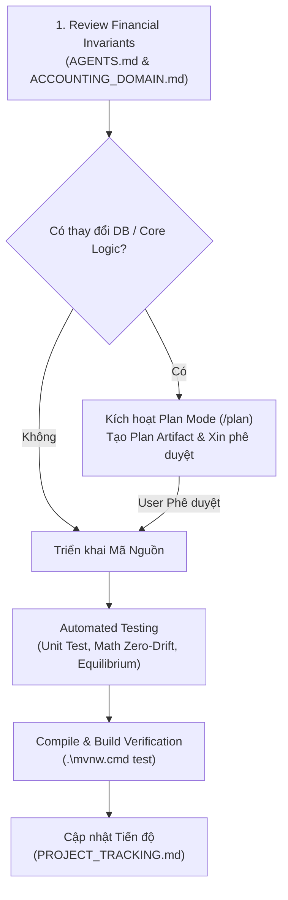

# Core Banking Project - Workflow & Operational Rules (`WORKFLOW.md`)

Tài liệu này quy định quy trình làm việc chuẩn (Standard Operating Procedure - SOP) cho mọi AI Agent và Developer tham gia phát triển dự án **Mini Core Banking System**.

---

## 1. Nguyên Tắc Bắt Buộc Kích Hoạt Chế Độ Lập Kế Hoạch (Plan Mode)

> [!IMPORTANT]
> **BẮT BUỘC KÍCH HOẠT PLAN MODE (`/plan`)** trước khi thực hiện bất kỳ thay đổi nào liên quan đến các hạng mục nhạy cảm sau đây:
> 1. **Thay đổi Schema / Database DDL**: Bất kỳ sửa đổi, bổ sung bảng, cột, khóa chính/ngoại, index hay file migration Flyway (`V*.sql`).
> 2. **Logic Nghiệp Vụ Tài Chính Cốt Lõi (Financial Business Logic)**:
>    - Ma trận định khoản kế toán (`ACCOUNTING_RULE_DEFINITION`).
>    - Thuật toán khóa dòng tránh Deadlock (`Deterministic Locking`).
>    - Cơ chế xác thực số dư (`Available = Ledger - Hold`).
>    - Công thức tính lãi và tích lũy dồn tích (`Interest Accrual Math`).
> 3. **Quy Trình Chạy Lô Cuối Ngày (EOD Batch Pipeline)**:
>    - Logic cắt sổ (`Cut-off`).
>    - Di chuyển dữ liệu Nóng/Lạnh (`MoveDataHis`).
>    - Tăng ngày làm việc ngân hàng (`Working Date Rollover`).
> 4. **Tái Cấu Trúc Kiến Trúc (Architecture Refactoring)**: Tách module Spring Modulith, thay đổi cơ chế Cache, hoặc đổi giao thức giao tiếp giữa các domain.

### Quy trình khi kích hoạt Plan Mode:
1. Tạo Artifact Kế hoạch triển khai (`<Artifact Directory>/<plan_name>.md`) với `RequestFeedback: true` và `UserFacing: true`.
2. Trình bày chi tiết: Mục tiêu, rủi ro tài chính, giải pháp DDL/Java, phương án kiểm thử và so sánh trước/sau.
3. **DỪNG LẠI và CHỜ USER PHÊ DUYỆT (Nhấn Proceed / Đồng ý)** trước khi chạm vào bất kỳ file code nào!

---

## 2. Quy Trình Cập Nhật Tiến Độ Dự Án (`PROJECT_TRACKING.md`)

Sau mỗi phiên làm việc hoặc hoàn thành một tính năng/task:
1. Agent **BẮT BUỘC** cập nhật file [`PROJECT_TRACKING.md`](file:///D:/MyProgram/CoreBanking/.agents/PROJECT_TRACKING.md).
2. Đánh dấu trạng thái rõ ràng:
   - `[ ]` Chưa bắt đầu (Backlog / Planned)
   - `[-]` Đang thực hiện (In Progress)
   - `[x]` Đã hoàn thành & Đã kiểm thử (Completed & Tested)
3. Ghi lại ngày cập nhật, mã kiểm thử Maven (`mvnw test` / `compile`) và các quyết định kỹ thuật vừa chốt.

---

## 3. Quy Trình Phát Triển Một Tính Năng Mới (Feature Development Lifecycle)

Mỗi tính năng mới trong Core Banking phải tuân thủ nghiêm ngặt 5 bước:

### Chi tiết các bước:
- **Bước 1: Đọc tài liệu quy chuẩn**: Đọc [`AGENTS.md`](file:///D:/MyProgram/CoreBanking/.agents/AGENTS.md) và [`ACCOUNTING_DOMAIN.md`](file:///D:/MyProgram/CoreBanking/.agents/ACCOUNTING_DOMAIN.md) để không vi phạm các bất biến tài chính.
- **Bước 2 & 3: Thẩm định rủi ro & Plan Mode**: Nếu chạm đến DB hoặc logic tiền tệ, phải lập kế hoạch chi tiết.
- **Bước 4: Triển khai theo chuẩn Clean Code**:
  - DTO/Command dùng Java 21 `record`.
  - Số tiền luôn là `BigDecimal` có scale 4 và RoundingMode tường minh.
  - Trạng thái kiểm tra qua `@ValidCodeList(group = "...")`.
- **Bước 5 & 6: Xác minh**: Chạy `.\mvnw.cmd test` và `.\mvnw.cmd compile -DskipTests` để đảm bảo không lỗi cú pháp và kiểm thử tự động xanh 100%.
- **Bước 7: Cập nhật tài liệu**: Ghi nhận kết quả vào `PROJECT_TRACKING.md`.
