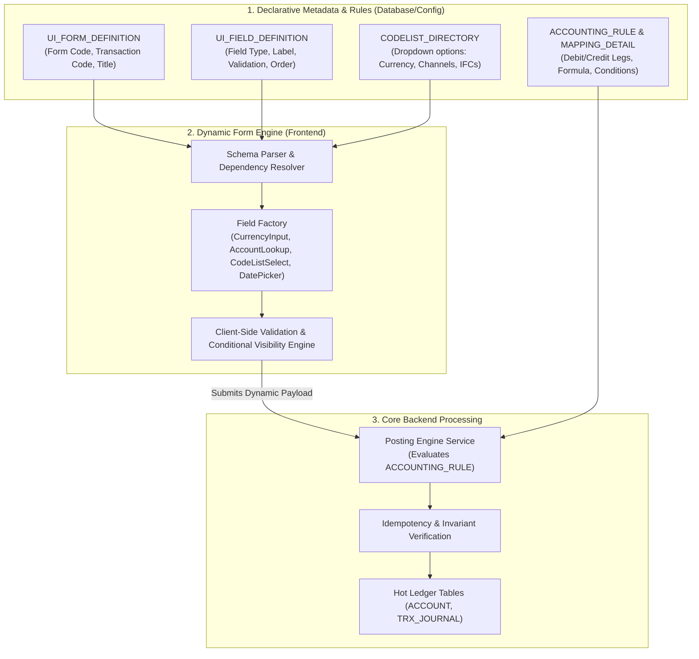

# 📐 Dynamic Form & Rule Engine: Architecture Design Decision (ADR)

> **Context & Intent**:  
> In real-world enterprise Core Banking platforms (such as Neptune CBS, Temenos T24, Oracle FLEXCUBE, Infosys Finacle), transaction screens, teller input behaviors, and accounting rules are almost **never hard-coded** into static UI forms. Instead, they rely on a **Metadata & Configuration-Driven Architecture**.  
> 
> This document details the architectural rationale behind this design, the business and technical problems it solves at scale, and the blueprint for the lightweight Dynamic Form Engine implemented in this project.

---

## I. Problem Statement: Why Static Forms Fail at Core Banking Scale

### 1. The Proliferation of Financial Products & Transactions
A typical universal bank manages between **300 to 1,000+ distinct transaction types** (`CASH_DEP`, `CASH_WDR`, `TRF_INTERNAL`, `TRF_INTERBANK`, `LOAN_DISBURSE`, `LOAN_REPAY`, `FX_SPOT`, `TIME_DEPOSIT_OPEN`, `FEE_COLLECTION`, etc.).
- **If hard-coded**: A bank would need hundreds of individual React/Angular forms.
- Any change (such as adding a "Tax Number" or "ID Issue Date" for transactions above 100,000,000 VND under State Bank of Vietnam anti-money laundering regulations) would require:
  1. Frontend code modification and code review.
  2. Mobile/Web app compilation, testing, and deployment cycles.
  3. Risk of version mismatches between Teller desks and the backend server.

### 2. The Semantic Gap Between Business Operations and Code
In banking, **Business Analysts (BAs)**, **Financial Controllers**, and **Risk Compliance Officers** define transaction requirements, regulatory checks, and accounting debits/credits.
- Hard-coded code creates a costly translation layer where developers constantly tweak UI forms for minor regulatory adjustments.
- A **Configuration-Driven Engine** allows business logic to be expressed as **declarative metadata**, enabling immediate product launch and zero-downtime policy updates.

---

## II. The Configuration-Driven Paradigm (First Principles)

### 1. Dynamic Forms as the Mirror of the Posting Matrix
In this Core Banking system, we already implemented a **Dynamic Posting Matrix** (`ACCOUNTING_RULE` and `ACCOUNT_MAPPING_DETAIL`) where transaction legs (`DR/CR`, GL accounts, fee formulas) are resolved at runtime without hardcoded Java logic.

The **Dynamic Form Engine** is the natural frontend mirror of this backend engine:
- The backend defines *what data it needs to post a transaction*.
- The Dynamic Form Engine inspects that metadata and dynamically renders the appropriate input controls, validations, and lookups.

---

## III. Core Capabilities of the UI Engine

| Feature | Description | Real-World Banking Counterpart |
| :--- | :--- | :--- |
| **Schema-Driven Inputs** | Forms are JSON/metadata objects specifying fields, types, and constraints. | Temenos T24 VERSION / Neptune CBS Screen Dictionary |
| **CodeList Integration** | Select dropdowns automatically bind to the backend `CodeListService` (`CURRENCY`, `REPAYMENT_TYPE`, `HOLD_REASON`). | Neptune CodeList / Oracle FLEXCUBE Static Data |
| **Smart Account Lookup** | Asynchronous account search with live validation, customer name resolution, and real-time Available/Hold balance badges. | Teller Inquiry / CIF Customer 360 |
| **Conditional Field Logic** | Fields show, hide, enable, or require values based on other field states (e.g. show `feeAmount` only if `isFeeWaived == false`). | Neptune CBS Conditional Validation Matrix |
| **Currency Masking & Precisions** | Formats numbers automatically with separators and 4-decimal accounting precision (`100,000,000.0000 VND`). | Multi-Currency Accounting Standard |

---

## IV. Architectural Boundary & Separation of Concerns

* **Zero Business Logic in UI Components**: UI components (`CurrencyField`, `AccountPicker`, `SelectField`) are purely presentational widgets. They have no knowledge of accounting rules or loan formulas.
* **Backend as Single Source of Truth**: The client-side dynamic form provides immediate user feedback and UX ergonomics, but the backend `PostingEngineService` and `Invariant Validator` re-validate all parameters authoritatively before touching the database.
* **Portable Definitions**: The same form definition schema can power the Web Teller Console, a mobile channel, or an automated test harness without altering code.
