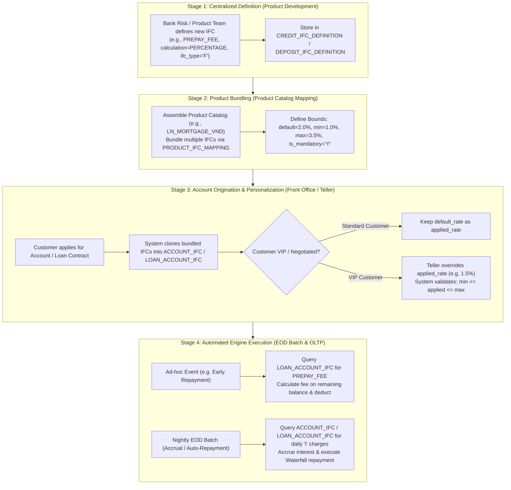

# 🏛️ Pluggable Multi-Charge IFC Pricing Engine Architecture

## 1. Executive Summary & Design Philosophy

In modern enterprise Core Banking Systems (e.g., Neptune CBS, Temenos T24, Finacle), interest rates and fee structures are never hardcoded as static columns inside product or account tables. Instead, financial pricing is abstracted into a decoupled **Interest & Fee Charge (IFC) Pricing Engine**.

An **IFC** is an independent, modular financial pricing component that defines:
- **Calculation Mechanism**: Percentage-based (`PERCENTAGE`), Flat Amount (`FLAT`), or Tiered/Slab (`SLAB`).
- **Frequency**: Daily accrual (`DAILY`), Monthly charge (`MONTHLY`), or One-off event (`ONETIME`).
- **Charge Type**: Interest (`'I'`) or Fee/Commission (`'F'`).
- **Accounting Mapping**: Corresponding Revenue / Expense and Receivable / Payable General Ledger accounts.

By employing a **Many-to-Many ($N-N$) Relationship** between **Product Catalogs**, **IFC Definitions**, and **Account Instances**, the bank gains infinite flexibility to assemble diverse financial packages (e.g., VIP Payroll CASA, Promotional Mortgages, Green Auto Loans) with zero database migrations or Java code changes.

---

## 2. Symmetrical Entity-Relationship (ER) Diagram: DPT & CRD

The diagram below displays the symmetrical $N-N$ architecture across both the **Deposit (DPT)** and **Credit (CRD)** modules:

```mermaid
erDiagram
    %% ==========================================
    %% DEPOSIT (DPT) SUBSYSTEM
    %% ==========================================
    DPT_PRODUCT_CATALOG ||--o{ DEPOSIT_PRODUCT_IFC_MAPPING : "configures (1:N)"
    DEPOSIT_IFC_DEFINITION ||--o{ DEPOSIT_PRODUCT_IFC_MAPPING : "included in (1:N)"
    ACCOUNT ||--o{ ACCOUNT_IFC : "applied charges (1:N)"
    DEPOSIT_IFC_DEFINITION ||--o{ ACCOUNT_IFC : "governed by (1:N)"

    DPT_PRODUCT_CATALOG {
        varchar product_code PK "e.g. CASA_STANDARD_VND, CASA_VIP_PAYROLL"
        varchar product_name "Product description"
        char currency "VND, USD"
        number min_balance "Required minimum opening balance"
        varchar is_active "Y / N"
    }

    DEPOSIT_IFC_DEFINITION {
        varchar ifc_code PK "e.g. INT_SAVINGS_DEMAND, FEE_MONTHLY_MAINT, FEE_MIN_BAL"
        varchar ifc_name "Human-readable charge name"
        char ifc_type "'I' = Interest (Expense), 'F' = Fee (Income)"
        varchar calculation_method "PERCENTAGE, FLAT, SLAB"
        varchar frequency "DAILY, MONTHLY, ONETIME"
        varchar gl_income_mapping "GL mapping for fee revenue (e.g. 7110)"
        varchar gl_expense_mapping "GL mapping for interest expense (e.g. 8011)"
        varchar gl_payable_mapping "GL mapping for accrued payable (e.g. 4911)"
    }

    DEPOSIT_PRODUCT_IFC_MAPPING {
        number mapping_id PK "Sequence generated"
        varchar product_code FK "References DPT_PRODUCT_CATALOG"
        varchar ifc_code FK "References DEPOSIT_IFC_DEFINITION"
        number default_rate "Default interest rate or flat fee amount"
        number min_rate "Floor threshold for negotiation"
        number max_rate "Ceiling threshold"
        char is_mandatory "'Y' = Mandatory, 'N' = Optional Add-on"
    }

    ACCOUNT_IFC {
        number account_ifc_id PK "Sequence generated"
        number account_id FK "References ACCOUNT(account_id)"
        varchar ifc_code FK "References DEPOSIT_IFC_DEFINITION"
        number applied_rate "Actual rate/fee applied to this customer"
        char is_waived "'Y' = Waived (100% free), 'N' = Standard charge"
        date effective_from "Effective start date"
        date effective_to "Optional expiration date"
    }

    %% ==========================================
    %% CREDIT (CRD) SUBSYSTEM
    %% ==========================================
    CREDIT_PRODUCT_CATALOG ||--o{ CREDIT_PRODUCT_IFC_MAPPING : "configures (1:N)"
    CREDIT_IFC_DEFINITION ||--o{ CREDIT_PRODUCT_IFC_MAPPING : "included in (1:N)"
    LOAN_ACCOUNT ||--o{ LOAN_ACCOUNT_IFC : "applied charges (1:N)"
    CREDIT_IFC_DEFINITION ||--o{ LOAN_ACCOUNT_IFC : "governed by (1:N)"

    CREDIT_PRODUCT_CATALOG {
        varchar product_code PK "e.g. LN_CONSUMER_VND, LN_MORTGAGE_VND"
        varchar product_name "Product description"
        char currency "VND, USD"
        number min_term_months "Min allowable duration"
        number max_term_months "Max allowable duration"
        varchar principal_gl_code "e.g. 2111"
        varchar overdue_gl_code "e.g. 2112"
    }

    CREDIT_IFC_DEFINITION {
        varchar ifc_code PK "e.g. NORMAL_INT, OVERDUE_INT, ORIGINATION_FEE, PREPAY_FEE"
        varchar ifc_name "Human-readable charge name"
        char ifc_type "'I' = Interest (Revenue), 'F' = Fee (Income)"
        varchar calculation_method "PERCENTAGE, FLAT, SLAB"
        varchar frequency "DAILY, MONTHLY, ONETIME"
        varchar gl_income_mapping "GL mapping for interest/fee revenue (e.g. 7020, 7110)"
        varchar gl_receivable_mapping "GL mapping for accrued receivable (e.g. 3911)"
    }

    CREDIT_PRODUCT_IFC_MAPPING {
        number mapping_id PK "Sequence generated"
        varchar product_code FK "References CREDIT_PRODUCT_CATALOG"
        varchar ifc_code FK "References CREDIT_IFC_DEFINITION"
        number default_rate "Default rate / fee amount"
        number min_rate "Floor rate"
        number max_rate "Ceiling rate"
        char is_mandatory "'Y' = Mandatory, 'N' = Optional Add-on"
    }

    LOAN_ACCOUNT_IFC {
        number contract_ifc_id PK "Sequence generated"
        number loan_id FK "References LOAN_ACCOUNT(loan_id)"
        varchar ifc_code FK "References CREDIT_IFC_DEFINITION"
        number applied_rate "Final effective rate or fee amount"
        number margin_rate "Negotiated margin spread (+X.XX%)"
        char is_waived "'Y' = Waived, 'N' = Chargeable"
    }
```

---

## 3. End-to-End Operational Lifecycle Workflow

The following flowchart explains how an IFC moves from centralized definition to customer-level execution:

---

## 4. Subsystem Symmetry Comparison

| Architectural Dimension | Deposit (DPT) Subsystem | Credit (CRD) Subsystem |
| :--- | :--- | :--- |
| **Dictionary Table** | `DEPOSIT_IFC_DEFINITION` | `CREDIT_IFC_DEFINITION` |
| **$N-N$ Mapping Table** | `DEPOSIT_PRODUCT_IFC_MAPPING` | `CREDIT_PRODUCT_IFC_MAPPING` |
| **Account Instance Table** | `ACCOUNT_IFC` | `LOAN_ACCOUNT_IFC` |
| **Foreign Key Reference** | `account_id` $\rightarrow$ `ACCOUNT` | `loan_id` $\rightarrow$ `LOAN_ACCOUNT` |
| **Account Numbering** | `0014211000001001` (16 digits) | `0012111000000101` (16 digits) |
| **Primary Financial Impact** | Interest Expense (GL 8011) / Fee Income (GL 7110) | Interest Revenue (GL 7020) / Penalty / Provision |
| **Batch Consumer** | `InterestAccrualService` & EOM Fee Sweep | `LoanRepaymentService` (Waterfall) & `LoanAgingService` |
| **Historical Snapshot Bucket** | `ACCOUNT_BALANCE_BUCKET` | `LOAN_BALANCE_BUCKET` |

---

## 5. Summary of Enterprise Benefits
1. **Zero Schema Modification**: Introducing new regulatory fees or market promotions requires only simple SQL inserts into `_IFC_DEFINITION` and `_PRODUCT_IFC_MAPPING`.
2. **Personalized VIP Pricing**: Front-office staff can safely customize margins, waivers, and discounts per contract within mathematically validated boundaries.
3. **Audit Trail & Immutability**: Historical contracts retain their exact agreed-upon fee and interest conditions even if the parent product catalog is modified or decommissioned.
