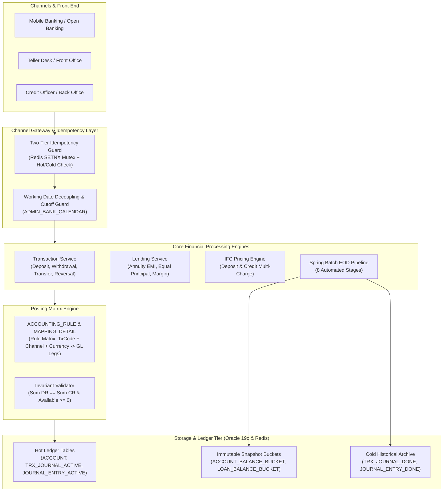
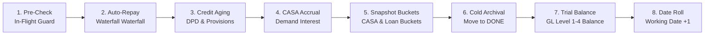

# 🏦 CORE BANKING SYSTEM ARCHITECTURE & PORTFOLIO SHOWCASE
> **High-Performance, Double-Entry Core Banking Platform**  
> *Engineered in compliance with SBV (State Bank of Vietnam) regulations and Tier-1 Banking Standards (Temenos T24, Oracle FLEXCUBE, Neptune CBS).*

---

## 🌟 Executive Summary

This project is a modern, enterprise-grade **Core Banking Engine** built from the ground up to solve the most difficult technical challenges in financial software engineering:
* **Strict Double-Entry Bookkeeping**: Absolute preservation of debit-credit equilibrium ($\sum \text{Debit} = \sum \text{Credit}$) across every financial event.
* **Zero-Deadlock Concurrency**: Mathematical deadlock prevention ($ORA\text{-}00060$) on multi-account transactions using deterministic row locking (`ORDER BY account_id ASC FOR UPDATE`) under massive Java 21 Virtual Thread load.
* **Two-Tier Composite Idempotency**: Redis L1 cache + Distributed Thundering-Herd Mutex + Hot/Cold Ledger checks guaranteeing zero double-charges.
* **Symmetrical Multi-Charge IFC Pricing Engine**: Dynamic catalog-driven bundling and contract-level cloning for both Deposit (`ACCOUNT_IFC`) and Credit (`LOAN_ACCOUNT_IFC`).
* **Lending & EOD Batch Pipeline**: Complete loan lifecycle (Origination, Schedule Generation, Disbursement, Waterfall Auto-Repayment, Circular 11/2021 Aging & Provisioning via TK 7911, and 8-Step Spring Batch EOD).

---

## 🏛️ System Architecture Overview



---

## ⚖️ The 6 Core Accounting Invariants

Every financial operation in the system is governed by 6 non-negotiable architectural invariants:

| Invariant | Principle | Engineering Implementation |
| :--- | :--- | :--- |
| **Invariant 1** | **Double-Entry Equilibrium** | $\sum \text{Debit} = \sum \text{Credit}$ enforced in `PostingEngineService`. Any single-penny asymmetry immediately rolls back the database transaction. |
| **Invariant 2** | **Balance Integrity** | $\text{Available} = \text{Ledger} - \text{Hold} \ge 0$. Pre-debit and pre-hold validation prevents phantom withdrawals or negative available balances. |
| **Invariant 3** | **Deterministic Row Locking** | Multi-account locks (`from_account`, `to_account`) are strictly sorted in memory (`ORDER BY account_id ASC`) before issuing `SELECT ... FOR UPDATE`, rendering circular wait deadlocks ($ORA\text{-}00060$) impossible. |
| **Invariant 4** | **Working Date Decoupling** | All financial postings and interest accruals bind to `working_date` from `ADMIN_BANK_CALENDAR`, completely decoupled from server wall-clock (`SYSDATE`). Strict cutoff enforcement rejects transactions after EOD trigger. |
| **Invariant 5** | **Two-Tier Composite Idempotency** | Composite key `(channel_id, idempotency_key)`. Redis L1 fast filter + Redis distributed lock for thundering herd + Hot table (`TRX_JOURNAL_ACTIVE`) + Cold archive (`TRX_JOURNAL_DONE`). |
| **Invariant 6** | **Audit Lineage & Storno Reversals** | No `UPDATE` or `DELETE` on financial entries. Reversals create exact symmetric opposite legs (`DR <-> CR`, `ST_REV` prefix) with parent-child linkage (`original_trx_id`). |

---

## 🔄 High Concurrency Stress Benchmark (Java 21 Virtual Threads)

The system includes a dedicated stress testing suite demonstrating massive concurrent throughput and mathematical reliability:

```mermaid
sequenceDiagram
    autonumber
    participant Client as 100 Virtual Threads
    participant Lock as Redis Idempotency Mutex
    participant DB as Oracle 19c (Row Lock Order)
    participant Engine as Posting Engine
    
    Client->>Lock: Concurrent Request with Identical/Ring Keys
    alt Same Idempotency Key (Thundering Herd)
        Lock-->>Client: 1 Thread acquires lock; 19 Threads wait & replay canonical receipt
    else Ring Transfers (A -> B -> C -> D -> A)
        Client->>DB: Lock A, B, C, D in ASCENDING order (account_id ASC)
        Note over DB: ZERO Circular Wait Deadlocks (0 ORA-00060)
        Client->>Engine: Post verified double-entry legs
        Engine->>DB: Commit balance mutations
    end
```

### Verified Test Scenarios:
1. **Multi-Party Ring Transfers**: 80 Virtual Threads executing circular transfers across 4 accounts ($A \rightarrow B \rightarrow C \rightarrow D \rightarrow A$). Result: **0 Deadlocks**, **100% Conservation of Total Balance**.
2. **Available Balance & Hold Contention**: 40 Virtual Threads competing for holds exceeding account funds. Result: **Exactly 20 accepted, exactly 20 rejected** with `InsufficientFundsException`. Zero negative balance violations.
3. **Thundering Herd Storm**: 20 Virtual Threads simultaneously firing identical transactions. Result: **1 physical debit/credit**, **19 instant replays** with identical `trxNumber`. Zero duplicate financial mutations.
4. **Concurrent Lending Disbursements**: Multiple borrowers disbursed into CASA simultaneously via Rule Matrix (`DR 2111 / CR 4211`). Result: 100% balanced journal legs and active contracts.

---

## 💳 Lending Engine & Symmetrical IFC Pricing

### 1. Symmetrical Multi-Charge IFC Architecture
A uniform, catalog-driven fee & interest charging engine for both Tiền gửi (Deposit) và Cho vay (Credit):
- **Dictionary**: `DEPOSIT_IFC_DEFINITION` & `CREDIT_IFC_DEFINITION` with `ifc_type CHAR(1)` (`'I'` = Interest, `'F'` = Fee).
- **Bundling**: $N-N$ mapping into Product Catalogs (`DEPOSIT_PRODUCT_IFC_MAPPING`, `CREDIT_PRODUCT_IFC_MAPPING`).
- **Contract Decoupling**: Bundled IFCs are cloned to `ACCOUNT_IFC` and `LOAN_ACCOUNT_IFC` on account opening, insulating active contracts from future catalog changes and allowing personalized VIP waivers/margins.

### 2. Two-Tier Margin Rate Floating Interest
$$\text{Effective Rate} = \text{Base Rate} + \text{Margin Rate}$$
- Teller negotiates within allowable product bounds: $\text{min\_margin\_rate} \le \text{margin} \le \text{max\_margin\_rate}$.
- Automatically binds `applied_rate` and `margin_rate` into `LOAN_ACCOUNT_IFC`.

### 3. Credit Aging & Dual-Provisioning (SBV Circular 11/2021)
- Automatic classification into 5 Debt Groups based on Days Past Due (DPD): Group 1 (Current), Group 2 (Special Mention), Group 3 (Sub-standard), Group 4 (Doubtful), Group 5 (Loss).
- Dual provisioning calculation:
  - **General Provision**: $0.75\%$ on unclassified eligible principal.
  - **Specific Provision**: $0\% \rightarrow 5\% \rightarrow 20\% \rightarrow 50\% \rightarrow 100\%$ according to Debt Group.
- **Accounting Invariant**: When a loan is paid off, all loss provisions are reversed via **TK 7911 (Thu nhập khác từ hoàn nhập dự phòng)**, maintaining balance sheet hygiene.

---

## 🌙 Automated 8-Step Spring Batch EOD Pipeline



1. **`preCheckStep`**: Rejects EOD run if any `IN_FLIGHT` transaction exists in hot tables.
2. **`loanRepaymentStep`**: Executes Waterfall auto-repayment from CASA (Fees $\rightarrow$ Overdue Interest $\rightarrow$ In-Term Interest $\rightarrow$ Overdue Principal $\rightarrow$ In-Term Principal).
3. **`loanAgingStep`**: Evaluates DPD, transitions groups (1-5), and computes general/specific provisions.
4. **`interestAccrualStep`**: Calculates daily demand deposit interest on CASA ledger balances.
5. **`snapshotStep`**: Freezes immutable daily balances into `ACCOUNT_BALANCE_BUCKET` and `LOAN_BALANCE_BUCKET`.
6. **`archivalStep`**: Archives finalized `COMPLETED`/`FAILED` transactions from hot tables to `_DONE` tables.
7. **`trialBalanceStep`**: Generates full hierarchical general ledger trial balance and asserts total debits equal total credits.
8. **`dateRollStep`**: Increments `working_date` to the next banking business day and re-enables transaction processing.

---

## 🔢 Account Numbering Standard (Pure 16 Digits)

The system strictly bans alphabetic prefixes (`LN...`, etc.) across all accounts to guarantee interoperability with payment switches:

$$\mathbf{Deposit\ Account\ (CASA)}: \quad \mathbf{Branch}\ (3) + \mathbf{GL\ 4211}\ (4) + \mathbf{Seq}\ (9) \quad \longrightarrow \quad \mathbf{0014211000001001}$$
$$\mathbf{Loan\ Account\ (Credit)}: \quad \mathbf{Branch}\ (3) + \mathbf{GL\ 2111}\ (4) + \mathbf{Seq}\ (9) \quad \longrightarrow \quad \mathbf{0012111000000101}$$

---

## 🧪 Test Suite & Code Quality Metrics

- **Total Test Cases**: **136 automated test cases** across Unit, Integration, Batch, and High-Concurrency Stress tests.
- **Pass Rate**: **100% (136/136 PASSED, 0 FAILURES, 0 ERRORS)**.
- **Database Engine**: Oracle Database 19c Enterprise Edition.
- **Cache & Mutex**: Redis 7.x (Standalone / Cluster-ready).
- **Core Frameworks**: Spring Boot 3.3.4, Java 21 LTS, Spring Batch 5.x, Hibernate / Spring Data JPA, Flyway 10.x.
