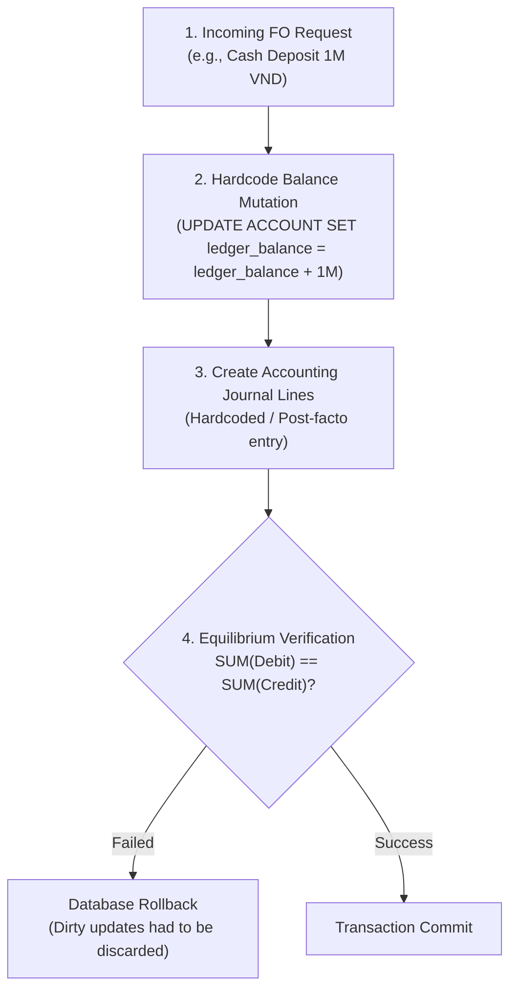
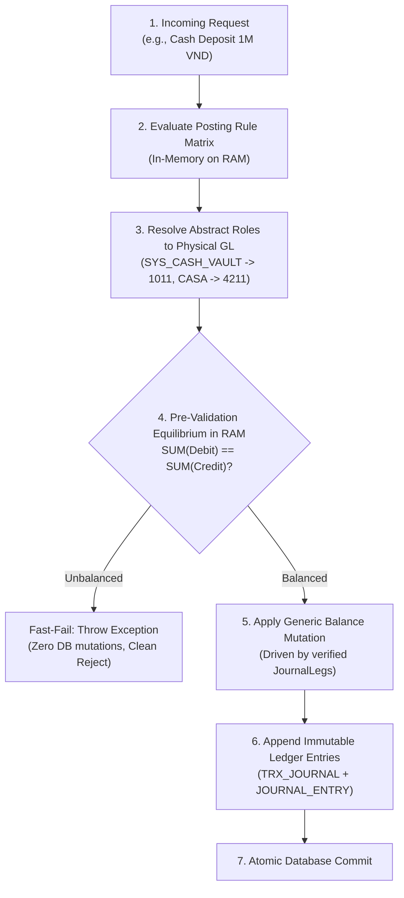
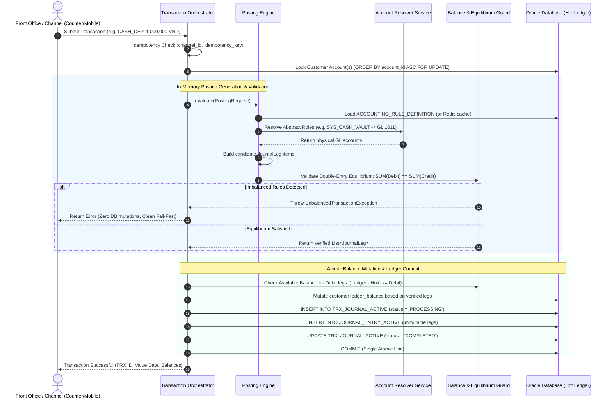

# 🏦 Posting-Driven Transaction Architecture in Core Banking

## 1. Overview & Comparison

In modern enterprise Core Banking systems (e.g., Neptune CBS, Temenos T24, Finacle), transaction processing is strictly **Posting-Driven** rather than balance-driven.

Instead of hardcoding account balance mutations inside service classes and treating accounting as an afterthought, every financial operation is dynamically governed by a pre-configured **Posting Rule Matrix** (`ACCOUNTING_RULE_DEFINITION`).

---

## 2. Architecture Comparison

### Anti-Pattern: Balance-First with Post-Validation (Brittle)

*Pitfalls*:
- Business logic is fragmented across service classes (`deposit()`, `withdraw()`, `transfer()`) and accounting tables.
- Adding new banking products (e.g., Loan Disbursement, Collateral Fee, EOD Capitalization) requires modifying Java code.
- Higher database contention due to early row mutations before transaction validation.

---

### Enterprise Pattern: Posting-Driven Transaction Lifecycle (Adopted)

#### High-Level Workflow (Flowchart)

#### Detailed Component Interaction (Sequence Diagram)

---

## 3. Key Benefits

1. **Single Source of Truth**:
   The `ACCOUNTING_RULE_DEFINITION` table completely governs which accounts are debited or credited. Java code does not contain hardcoded financial logic.
2. **Fail-Fast in RAM**:
   If a rule matrix definition is asymmetric or corrupted, `UnbalancedTransactionException` is raised immediately in memory before any database write occurs.
3. **Internal GL Scalability (No Hotspot Locks)**:
   Bank internal GL accounts (such as Cash Vault `1011`, Fee Income `7111`, Interest Expense `8011`) are not row-locked for balance updates on every concurrent customer transaction. They are written as append-only `JOURNAL_ENTRY` rows, and aggregated during End-of-Day (EOD) processing, eliminating database bottlenecks.
4. **Auditability & Regulatory Compliance**:
   Every balance mutation on a customer account is strictly backed by an immutable `JOURNAL_ENTRY` row carrying matching value dates, currency, and transaction lineage.
