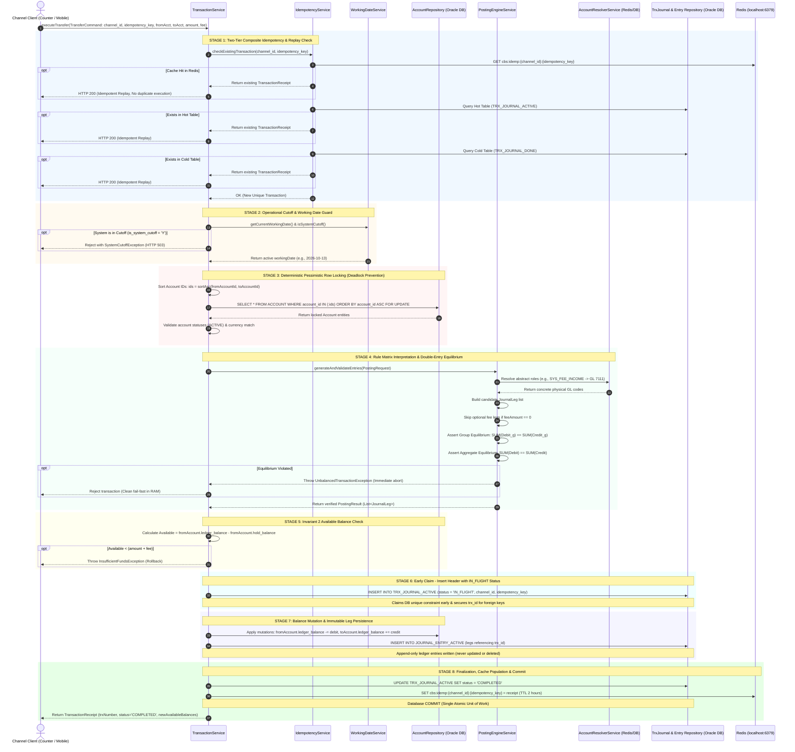

# 🏦 End-to-End Transaction Lifecycle in Core Banking

This document provides the definitive, comprehensive architecture and sequence diagram for the transaction lifecycle of the Mini Core Banking System.

---

## 1. High-Level Guarantees & Financial Invariants

Every financial transaction processed by the banking engine adheres to five strict invariants:
1. **Invariant 1 (Double-Entry Equilibrium)**: $\sum \text{Debit} == \sum \text{Credit}$ enforced in memory before any database write.
2. **Invariant 2 (Balance Integrity)**: $\text{Available Balance} = \text{Ledger Balance} - \text{Hold Balance}$. Overdrafts are prohibited.
3. **Invariant 3 (Deterministic Row Locking)**: All participating accounts are locked in strictly ascending order:
   ```sql
   SELECT * FROM ACCOUNT WHERE account_id IN (:ids) ORDER BY account_id ASC FOR UPDATE;
   ```
   This mathematically prevents database deadlocks (`ORA-00060`) regardless of concurrency direction ($A \rightarrow B$ vs $B \rightarrow A$).
4. **Invariant 4 (Decoupled Operational Calendar)**: Financial value dates are driven by `SYSTEM_OPERATIONAL_STATUS.current_working_date`, not physical server clocks (`LocalDate.now()`).
5. **Invariant 5 (Two-Tier Composite Idempotency)**: Uniqueness of `(channel_id, idempotency_key)` is enforced across Redis, Hot Journal (`TRX_JOURNAL_ACTIVE`), and Cold Archive (`TRX_JOURNAL_DONE`).

---

## 2. Complete End-to-End Sequence Diagram



---

## 3. Step-by-Step Technical Rationale

### Stage 1: Two-Tier Composite Idempotency & Replay Gate
- Network retries, mobile app double-taps, and timeout recoveries are standard in financial channels.
- Before acquiring any expensive database row locks, the engine checks whether `(channel_id, idempotency_key)` has already been processed:
  1. **L1 (Redis Fast Filter)**: Key `cbs:idemp:{channel_id}:{idempotency_key}` provides sub-millisecond replay.
  2. **Hot Ledger Table**: Queries `TRX_JOURNAL_ACTIVE`.
  3. **Cold Archive Table**: Queries `TRX_JOURNAL_DONE` for transactions settled on earlier dates.
- If found, it returns the previous receipt without executing financial mutations twice (**Idempotent Replay**).

### Stage 2: Operational Cutoff & Working Date Guard
- If End-of-Day (EOD) processing is in flight (`is_system_cutoff = 'Y'`), incoming counter/channel requests are immediately rejected with `503 Service Unavailable`.
- Value dates are assigned from `SYSTEM_OPERATIONAL_STATUS.current_working_date`, ensuring ledger alignment even if the calendar rolls over at midnight.

### Stage 3: Deterministic Pessimistic Row Locking (Deadlock Prevention)
- In a concurrent banking system, two clients may initiate simultaneous transfers in opposite directions:
  - Client 1: transfers Account 100 $\rightarrow$ Account 200.
  - Client 2: transfers Account 200 $\rightarrow$ Account 100.
- If locks were acquired in request order, a database deadlock (`ORA-00060`) would occur.
- **The Core Banking Fix**:
  The system always sorts account IDs: $\min(100, 200) = 100$, then $\max(100, 200) = 200$. Both threads lock Account 100 first, then Account 200. The second thread waits cleanly on the first lock without deadlock.

### Stage 4: Rule Matrix Interpretation & Equilibrium
- Business logic is governed by `ACCOUNTING_RULE_DEFINITION` rather than Java `if/else`.
- The engine dynamically maps roles (`SYSTEM_GL` $\rightarrow$ GL codes via `AccountResolverService`, `CUSTOMER_ACCOUNT` $\rightarrow$ Account control GLs).
- Validates that $\sum \text{Debit} == \sum \text{Credit}$ both per entry group and across the entire transaction.

### Stage 5: Invariant 2 Balance Integrity Check
- Asserts $\text{Available Balance} = \text{Ledger Balance} - \text{Hold Balance} \ge \text{Debit Amount}$.
- Active earmarks (`ACCOUNT_HOLD`) are preserved intact.

### Stage 6: Early Header Claim (`IN_FLIGHT`)
- `TRX_JOURNAL_ACTIVE` is inserted with status `'IN_FLIGHT'`.
- This claims the composite unique constraint `uq_trx_act_composite_idemp (channel_id, idempotency_key)` at the database level early, and generates the `trx_id` required by the foreign key constraint `fk_entry_act_trx` on `JOURNAL_ENTRY_ACTIVE`.

### Stage 7: Ledger Mutation & Append-Only Legs
- `ACCOUNT.ledger_balance` is mutated based exclusively on verified legs.
- `JOURNAL_ENTRY_ACTIVE` rows are inserted as append-only records.

### Stage 8: Finalization & Commit
- `TRX_JOURNAL_ACTIVE.status` is updated to `'COMPLETED'`.
- The transaction commits atomically. Redis cache is populated with the receipt for fast idempotent replay.
