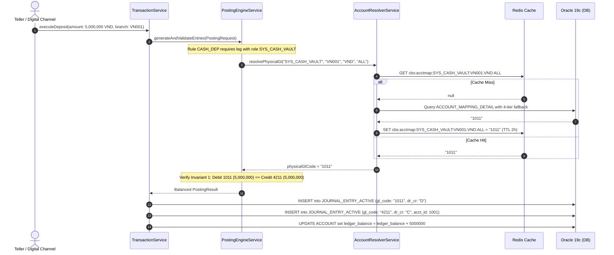
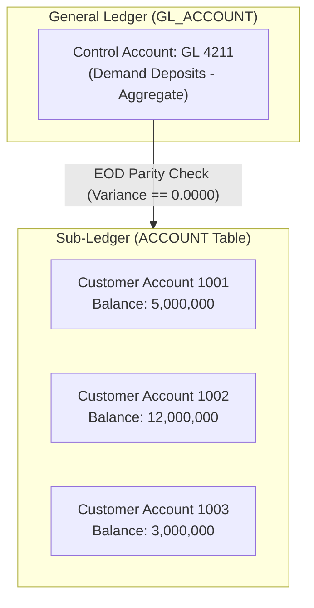

# Chart of Accounts and Account Mapping Architecture

This document details the General Ledger (GL) design, the statutory Chart of Accounts (COA) hierarchy, and the architectural rationale behind the Account Abstraction Layer (`ACCOUNT_MAPPING`) in the Mini Core Banking System.

---

## 1. Banking Domain Background: Statutory COA vs. Internal Sub-GLs

Banking Chart of Accounts (COA) balances two requirements:
- **Central Bank Statutory Mandate**: Unified 1-to-4 digit accounts (e.g. SBV Decision 479/2004/QD-NHNN) ensuring identical regulatory reporting across all institutions.
- **Commercial Bank Customization**: Sub-accounts (level 4+) defined internally by each bank to segregate branches, currencies, and customer segments.

### The Hybrid COA Hierarchy

The Chart of Accounts is structured as a hierarchical tree:

```text
Class 4 (Liabilities / Customer Deposits)         <-- Strictly Fixed by Central Bank
  └── Group 42 (Deposits of Entities & Citizens)  <-- Strictly Fixed by Central Bank
       └── Account 4211 (Demand Deposits in VND)  <-- Strictly Fixed by Central Bank
            ├── 4211.01 (Retail CASA - Branch A)  <-- Defined Internally by Bank A
            └── 4211.02 (Corporate Checking)      <-- Defined Internally by Bank A
```

### Statutory Account Classes

| Class | Accounting Type | Normal Balance | Standard Examples | Economic Substance |
| :--- | :--- | :--- | :--- | :--- |
| **`1xxx`** | **Asset** | Debit (`D`) | `1011` (VND Cash on Hand), `1031` (Foreign Currency Cash) | Vault cash, interbank clearing balances, reserve deposits at Central Bank. |
| **`2xxx`** | **Asset** | Debit (`D`) | `2111` (Standard Short-Term Loan), `2112` (Special Mention Loan), `2191` (Loan Loss Reserve) | Customer lending principal, overdraft assets, and credit loss provisions. |
| **`4xxx`** | **Liability** | Credit (`C`) | `4211` (Demand Deposits - CASA), `4221` (Term Deposits), `4911` (Accrued Interest Payable) | Customer deposits, borrowings from other financial institutions, payables. |
| **`7xxx`** | **Revenue** | Credit (`C`) | `7020` (Loan Interest Income), `7111` (Transaction Fee Income), `7911` (Provision Reversal Income) | Bank operating and non-operating revenue. |
| **`8xxx`** | **Expense** | Debit (`D`) | `8011` (Deposit Interest Expense), `8822` (Credit Risk Provisioning Expense) | Cost of funds, operational expenses, risk provisioning costs. |

---

## 2. The Core Problem: Why Hardcoded GL Codes Fail

If a core banking engine hardcodes physical GL numbers in source code:
```java
// ANTI-PATTERN: Tightly coupled, brittle, non-portable
journalEntry.setGlCode("1011");
```

This design immediately collapses under real-world banking constraints:
1. **Multi-Branch Operations**: Branch `VN001` (Hanoi) and Branch `VN002` (Ho Chi Minh City) maintain distinct physical vaults. Their journal entries must route to distinct vault accounts (`1011.01` vs `1011.02`) to balance individual branch balance sheets.
2. **Multi-Currency Operations**: Depositing US Dollars (`USD`) into a teller drawer cannot be posted to a Vietnamese Dong (`VND`) GL (`1011`). It must route to the foreign currency vault (`1031`).
3. **Product & Segment Segmentation**: Fee income from a retail mobile transfer might be categorized under `7111.RETAIL`, whereas an institutional corporate wire routes to `7111.CORP`.
4. **Software Portability Across Banks**: Commercial core banking engines (such as Temenos T24, Oracle FLEXCUBE, and Neptune CBS) are deployed across hundreds of different institutions. If posting rules hardcode account numbers, the vendor would have to rewrite code for every client bank.

---

## 3. The Solution: Account Abstraction Layer (`ACCOUNT_MAPPING`)

To decouple business logic from physical ledger configuration, the engine introduces an **Account Abstraction Layer**.

Transaction posting rules never reference physical numbers like `1011` or `7111`. Instead, they reference **Abstract Accounting Roles**:
- `SYS_CASH_VAULT` (Physical teller drawer / cash vault)
- `SYS_FEE_INCOME` (Transaction service fee revenue)
- `SYS_INT_REVENUE` (Lending contractual interest earnings)
- `SYS_INT_EXPENSE` (Deposit interest expense)
- `SYS_PROV_REVERSAL_INCOME` (Loan loss provision recovery revenue)

### Database Schema

The abstraction is governed by two parameter tables:

```sql
-- 1. Master Catalog of Abstract Roles
CREATE TABLE ACCOUNT_MAPPING (
    mapping_id          VARCHAR2(30 CHAR)   PRIMARY KEY, -- e.g., 'SYS_CASH_VAULT'
    mapping_name        VARCHAR2(100 CHAR)  NOT NULL,
    account_type        VARCHAR2(15 CHAR)   NOT NULL,    -- ASSET, LIABILITY, etc.
    description         VARCHAR2(255 CHAR)
);

-- 2. Contextual Routing Matrix
CREATE TABLE ACCOUNT_MAPPING_DETAIL (
    detail_id           NUMBER(19)          PRIMARY KEY,
    mapping_id          VARCHAR2(30 CHAR)   NOT NULL REFERENCES ACCOUNT_MAPPING(mapping_id),
    branch_code         VARCHAR2(10 CHAR)   DEFAULT 'ALL' NOT NULL,
    currency            CHAR(3)             DEFAULT 'ALL' NOT NULL,
    product_code        VARCHAR2(10 CHAR)   DEFAULT 'ALL' NOT NULL,
    physical_gl_code    VARCHAR2(20 CHAR)   NOT NULL REFERENCES GL_ACCOUNT(gl_code),
    is_active           CHAR(1)             DEFAULT 'Y' NOT NULL,
    CONSTRAINT uq_acct_map_rule UNIQUE (mapping_id, branch_code, currency, product_code)
);
```

---

## 4. The 4-Tier Contextual Resolution Matrix

When the engine executes a transaction, [`AccountResolverService.java`](../src/main/java/com/cbs/accounting/service/AccountResolverService.java) resolves the concrete physical GL using a 4-tier hierarchical fallback:

```text
Tier 1 (Exact Context Match):      (mapping_id, branch_code, currency, product_code)
Tier 2 (Product Wildcard Fallback): (mapping_id, branch_code, currency, 'ALL')
Tier 3 (Branch Wildcard Fallback):  (mapping_id, 'ALL', currency, 'ALL')
Tier 4 (System Default):            (mapping_id, 'ALL', 'ALL', 'ALL')
```

### Concrete Database Configuration Example

```sql
-- 1. Nationwide default: All branches, all products, VND vault -> 1011
INSERT INTO ACCOUNT_MAPPING_DETAIL VALUES 
(1, 'SYS_CASH_VAULT', 'ALL', 'VND', 'ALL', '1011', 'Y');

-- 2. Foreign currency override: All branches, USD vault -> 1031
INSERT INTO ACCOUNT_MAPPING_DETAIL VALUES 
(2, 'SYS_CASH_VAULT', 'ALL', 'USD', 'ALL', '1031', 'Y');

-- 3. Branch override: Head Office (VN001) uses sub-account 1011.01
INSERT INTO ACCOUNT_MAPPING_DETAIL VALUES 
(3, 'SYS_CASH_VAULT', 'VN001', 'VND', 'ALL', '1011.01', 'Y');

-- 4. Product-specific fee revenue: VIP product fees route to GL 7112
INSERT INTO ACCOUNT_MAPPING_DETAIL VALUES 
(4, 'SYS_FEE_INCOME', 'ALL', 'VND', 'VIP_CASA', '7112', 'Y');
```

**Benefits**:
- **Zero Configuration Bloat**: Administrators configure nationwide defaults once with wildcard `'ALL'`. They only insert new rows when an exception or override is required.
- **Instant Product Rollout**: Introducing a new deposit product requires zero database migration scripts or code changes.

---

## 5. Performance Strategy: In-Memory L1 Cache via Redis

Resolving multi-column database lookups for every financial leg during daytime peak OLTP creates unnecessary database I/O. 

`AccountResolverService` implements an automatic **Cache-Aside Pattern** using Redis:

```text
Incoming Leg (Role: SYS_CASH_VAULT, Branch: VN001, CCY: VND, Prod: ALL)
                                │
                                ▼
         Check Redis: "cbs:acctmap:SYS_CASH_VAULT:VN001:VND:ALL"
                                │
               ┌────────────────┴────────────────┐
               ▼                                 ▼
         [ Cache Hit ]                     [ Cache Miss ]
       Return GL ("1011")                        │
      (Latency < 0.5 ms)                         ▼
                                       Query Oracle Database
                                       Hierarchical Fallback
                                                 │
                                                 ▼
                                        Write to Redis Cache
                                          (TTL = 2 Hours)
                                                 │
                                                 ▼
                                            Return "1011"
```

### Cache Invalidation on Parameter Update
When an accounting officer updates a mapping row in `ACCOUNT_MAPPING_DETAIL`:
1. The service invokes `AccountResolverService.evictCache(mappingId)`.
2. All keys matching pattern `cbs:acctmap:{mappingId}:*` are evicted immediately.
3. Subsequent transactions reload the latest database parameters without application restart or downtime.

---

## 6. End-to-End Sequence: Abstract Role to Journal Ledger



---

## 7. Sub-Ledger vs. General Ledger Reconciliation

A fundamental principle of core banking architecture is the structural separation between the **Sub-Ledger** and the **General Ledger**:



During Step 7 of the End-of-Day batch pipeline ([`TrialBalanceService.java`](../src/main/java/com/cbs/eod/service/TrialBalanceService.java)), the engine enforces:
$$\sum_{a \in \text{CASA Accounts}} a.\text{balance} \equiv \text{Net Balance of GL 4211}$$

If even `0.0001` variance is detected between the individual sub-ledger accounts and the control GL balance, the pipeline immediately raises a `SubledgerGlDiscrepancyException` and halts EOD processing, preventing date rollover until resolved.
