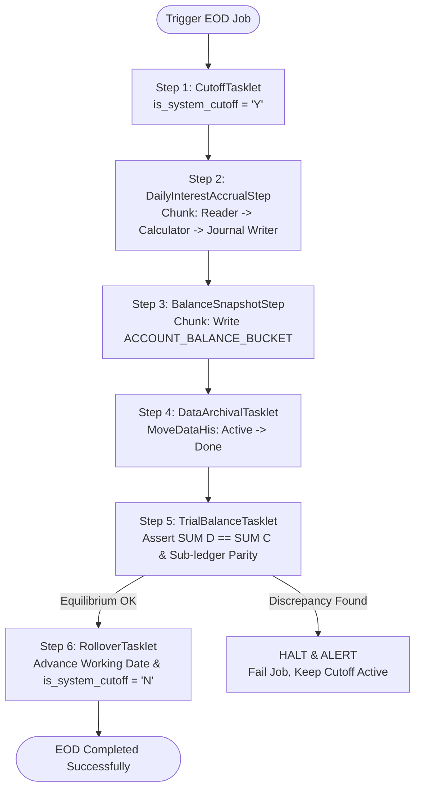

# 🏦 End-of-Day (EOD) Batch Pipeline Architecture

This document provides the definitive architecture, sequence diagrams, and financial guarantees for the **End-of-Day (EOD) Batch Processing Pipeline** of the Core Banking System.

---

## 1. High-Level Overview & Core Banking Principles

In commercial banking, 24/7 transaction processing is split into two operational modes:
1. **Daytime Window (Online OLTP Processing)**: Processes real-time transfers, deposits, withdrawals, and payments.
2. **Nightly Batch Window (EOD Batch Processing)**: Temporarily halts daytime mutations via **System Cut-off**, runs interest accrual calculations, takes regulatory balance snapshots, archives completed hot transactions to cold storage, validates ledger trial balance equilibrium, and rolls the operational calendar over to the next business day.

### Financial Invariants Enforced in EOD:
- **Invariant 4 (Decoupled Operational Calendar)**: The core banking value date is governed exclusively by `SYSTEM_OPERATIONAL_STATUS.current_working_date` and `BANK_CALENDAR`, decoupled from the physical operating system clock (`LocalDate.now()`).
- **Invariant 1 (Double-Entry Equilibrium on Accrual)**: Nightly interest accruals post balanced journal entries:
  $$\text{Debit GL 8011 (Interest Expense)} \equiv \text{Credit GL 4911 (Accrued Interest Payable)}$$
- **Invariant 2 (Balance Integrity & Historical Bucketing)**: Daily closing balances are recorded into immutable snapshot buckets (`ACCOUNT_BALANCE_BUCKET`).
- **Zero-Tolerance Trial Balance Reconciliation**: The fundamental core banking equation must balance across all general ledger accounts:
  $$\sum \text{Debit Balances} \equiv \sum \text{Credit Balances} \quad \text{and} \quad \text{GL 4211 Balance} \equiv \sum_{a \in \text{CASA}} a.\text{ledger\_balance}$$
  *If a discrepancy of even 0.0001 is detected, the EOD pipeline halts immediately and prevents business date rollover.*
- **Hot-to-Cold Data Archival (`MoveDataHis`)**: Moves finished transactions from hot active tables (`*_ACTIVE`) to cold history tables (`*_DONE`) to ensure the OLTP database remains ultra-lean and sub-millisecond fast.

---

## 2. Complete End-to-End EOD Sequence Diagram

```mermaid
sequenceDiagram
    autonumber
    actor Admin as EOD Scheduler / Operator
    participant EOD as EodBatchService (Spring Batch)
    participant WorkDate as WorkingDateService
    participant Accrual as InterestAccrualService
    participant Bucket as BalanceBucketService
    participant Archival as DataArchivalService
    participant Trial as TrialBalanceService
    participant DB as Oracle Database (COREBANKING_PDB)

    Admin->>EOD: triggerEodPipeline()

    rect rgb(255, 240, 240)
        Note over EOD, WorkDate: STAGE 1: System Cut-off & Online Freezing
        EOD->>WorkDate: enableCutoff()
        WorkDate->>DB: UPDATE SYSTEM_OPERATIONAL_STATUS SET is_system_cutoff = 'Y'
        Note over DB: Daytime APIs reject new transfers with "Core Banking is in Cutoff"
    end

    rect rgb(240, 248, 255)
        Note over EOD, Accrual: STAGE 2: Daily Savings & CASA Interest Accrual
        EOD->>Accrual: processDailyAccrual(currentWorkingDate)
        Accrual->>DB: Read active CASA/Savings accounts with positive balances
        loop For Each Eligible Account
            Accrual->>Accrual: Calculate interest: round(ledger_balance * annual_rate / day_count_basis, 4)
            Accrual->>DB: UPDATE ACCOUNT SET accrued_interest = accrued_interest + interest
        end
        Accrual->>DB: Post EOD_ACCRUAL Journal (DR 8011 Interest Expense / CR 4911 Interest Payable)
        Note over Accrual, DB: Invariant 1: Sum(Debit) == Sum(Credit) verified before committing
    end

    rect rgb(240, 255, 240)
        Note over EOD, Bucket: STAGE 3: Account Balance Snapshot Buckets
        EOD->>Bucket: captureBalanceBuckets(currentWorkingDate)
        Bucket->>DB: INSERT INTO ACCOUNT_BALANCE_BUCKET (account_id, working_date, closing_balance, accrued_interest, hold_balance)
        Note over Bucket, DB: Freezes immutable end-of-day balances for statements and audit
    end

    rect rgb(255, 250, 240)
        Note over EOD, Archival: STAGE 4: Hot-to-Cold Data Archival (MoveDataHis)
        EOD->>Archival: archiveCompletedTransactions(currentWorkingDate)
        Archival->>DB: INSERT INTO TRX_JOURNAL_DONE SELECT * FROM TRX_JOURNAL_ACTIVE WHERE status IN ('COMPLETED', 'FAILED')
        Archival->>DB: INSERT INTO JOURNAL_ENTRY_DONE SELECT * FROM JOURNAL_ENTRY_ACTIVE WHERE trx_id IN (archived_ids)
        Archival->>DB: DELETE FROM JOURNAL_ENTRY_ACTIVE WHERE trx_id IN (archived_ids)
        Archival->>DB: DELETE FROM TRX_JOURNAL_ACTIVE WHERE trx_id IN (archived_ids)
        Note over Archival, DB: Keeps active tables compact; preserves idempotency in cold archive
    end

    rect rgb(248, 240, 255)
        Note over EOD, Trial: STAGE 5: Trial Balance General Ledger Reconciliation
        EOD->>Trial: verifyGeneralLedgerEquilibrium(currentWorkingDate)
        Trial->>DB: SELECT SUM(debit) - SUM(credit) FROM GL_ACCOUNT
        Trial->>DB: SELECT GL 4211 balance VS SUM(CASA ledger_balance)
        alt Unbalanced Ledger or Subledger Mismatch Detected
            Trial-->>EOD: Throw TrialBalanceUnbalancedException
            Note over EOD, Admin: CRITICAL HALT: Date rollover aborted; Cutoff remains active
        end
        Trial-->>EOD: Ledger Equilibrium Confirmed
    end

    rect rgb(255, 255, 240)
        Note over EOD, WorkDate: STAGE 6: Operational Date Rollover & Cut-off Release
        EOD->>WorkDate: rolloverToNextWorkingDate()
        WorkDate->>DB: SELECT MIN(calendar_date) FROM BANK_CALENDAR WHERE calendar_date > current AND is_working_day = 'Y'
        WorkDate->>DB: UPDATE SYSTEM_OPERATIONAL_STATUS SET current_working_date = nextDate, is_system_cutoff = 'N'
        WorkDate-->>EOD: Rollover Complete
        Note over DB: Daytime APIs reopened for the new business working date
    end

    EOD-->>Admin: EodExecutionReport (STATUS = SUCCESS, New Working Date)
```

---

## 3. Spring Batch Orchestration Flow

The pipeline is orchestrated as a unified, restartable Spring Batch Job (`EOD_JOB`):



---

## 4. Detailed Stage Breakdown

### Stage 1: System Cut-off
- **Purpose**: Establishes a static data snapshot by blocking incoming daytime transaction mutations.
- **Mechanism**: Sets `SYSTEM_OPERATIONAL_STATUS.is_system_cutoff = 'Y'`.
- **API Guard**: Any call to `TransactionService.transfer()`, `deposit()`, `withdraw()`, or `reverse()` immediately throws `IllegalStateException("Core banking system is currently in Cutoff for EOD batch processing")`.

### Stage 2: Daily Savings & CASA Interest Accrual
- **Formula**:
  $$\text{Daily Accrual} = \text{round}\left( \text{ledger\_balance} \times \frac{\text{annual\_rate}}{\text{day\_count\_basis}}, 4 \right)$$
  - Supported conventions: `ACT_365` (365 days) and `ACT_360` (360 days).
  - Skips zero or negative balances.
- **Sub-ledger Update**: Increments `ACCOUNT.accrued_interest`.
- **General Ledger Postings (`EOD_ACCRUAL`)**:
  - **Debit**: GL `8011` (Chi phí trả lãi tiền gửi CASA / `SYS_INTEREST_EXPENSE`).
  - **Credit**: GL `4911` (Lãi phải trả cho tiền gửi CASA / `SYS_ACCRUED_INTEREST_PAYABLE`).
  - Verified by `PostingEngineService` to guarantee $\sum \text{Debit} == \sum \text{Credit}$.

### Stage 3: Loan Auto-Repayment (Waterfall Allocation)
- **Purpose**: Automatically recovers due and overdue loan installments by debiting linked borrower CASA accounts.
- **Deduction Priority**: Late Fee / Penalty $\rightarrow$ Overdue Interest $\rightarrow$ Normal Interest $\rightarrow$ Overdue Principal $\rightarrow$ Normal Principal.
- **Accounting Matrix (`LOAN_REPAY`)**:
  - **Debit**: GL `4211` (`CUSTOMER_ACCOUNT` - CASA Deposit reduction)
  - **Credit**: GL `7020` (`SYS_INT_REVENUE` - Interest Income recognition)
  - **Credit**: GL `2111` / `2112` (`SYS_LOAN_PRINCIPAL` / `SYS_LOAN_OVERDUE` - Loan Asset reduction)
- **Detailed Specification**: See [Waterfall Repayment Mechanism](WATERFALL_REPAYMENT_MECHANISM.md).

### Stage 4: Loan Aging, Classification & Dual Provisioning
- **Purpose**: Calculates Days Past Due (DPD) for loans, updates classification groups (Groups 1–5), transfers overdue principal to GL `2112`, and posts dual loan loss provisions.
- **General Provision**: $0.75\%$ on Groups 1–4 (DR `8822` / CR `2191`).
- **Specific Provision**: $0\%$ G1, $5\%$ G2, $20\%$ G3, $50\%$ G4, $100\%$ G5 (DR `8821` / CR `2192`).
- **Provision Reversal on Payoff**: When loans are settled, provisions are reversed into income (DR `2191`/`2192`, CR `7911` `SYS_PROV_REVERSAL_INCOME`).

### Stage 5: Account Balance Snapshot Buckets
- **Purpose**: Creates an immutable audit snapshot for every account as of the closing working date.
- **Target Table**: `ACCOUNT_BALANCE_BUCKET (account_id, working_date, closing_balance, accrued_interest, hold_balance)`.
- **Benefit**: Enables fast monthly interest capitalization, historical customer account statements, and tax reporting without scanning raw transaction logs.

### Stage 6: Hot-to-Cold Data Archival (`MoveDataHis`)
- **Criteria**: Migrates all transactions in `TRX_JOURNAL_ACTIVE` having status `COMPLETED` or `FAILED` with `working_date <= current_working_date`.
- **Exclusion**: Transactions in `IN_FLIGHT` are **never archived** (flagged for administrator inspection).
- **Execution**: Copies data to `TRX_JOURNAL_DONE` and `JOURNAL_ENTRY_DONE`, then purges the corresponding rows from `TRX_JOURNAL_ACTIVE` and `JOURNAL_ENTRY_ACTIVE` in a single atomic database transaction.

### Stage 7: Trial Balance General Ledger Reconciliation
- **Equilibrium Check**:
  $$\sum_{\text{All Postable GLs}} \text{Debit Total} - \sum_{\text{All Postable GLs}} \text{Credit Total} = 0$$
- **Sub-Ledger Parity Check**:
  $$\text{GL 4211 Net Balance} \equiv \sum_{a \in \text{CASA Accounts}} a.\text{ledger\_balance}$$
- **Fail-Safe Mechanism**: If even 0.0001 discrepancy is detected, `TrialBalanceUnbalancedException` is raised, aborting Step 8.

### Stage 8: Operational Date Rollover & Cut-off Release
- **Next Date Determination**:
  ```sql
  SELECT MIN(calendar_date) 
  FROM BANK_CALENDAR 
  WHERE calendar_date > :current_working_date 
    AND is_working_day = 'Y';
  ```
  Automatically skips weekend non-working days and declared public holidays.
- **Date Advancement**: Updates `SYSTEM_OPERATIONAL_STATUS.current_working_date = :next_date`.
- **Reopen Cut-off**: Sets `is_system_cutoff = 'N'`.
- **Redis Sync**: Warmed-up caches are refreshed for the new business working date.
