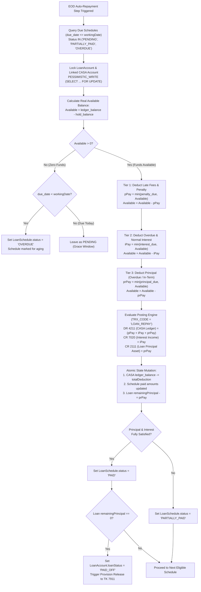
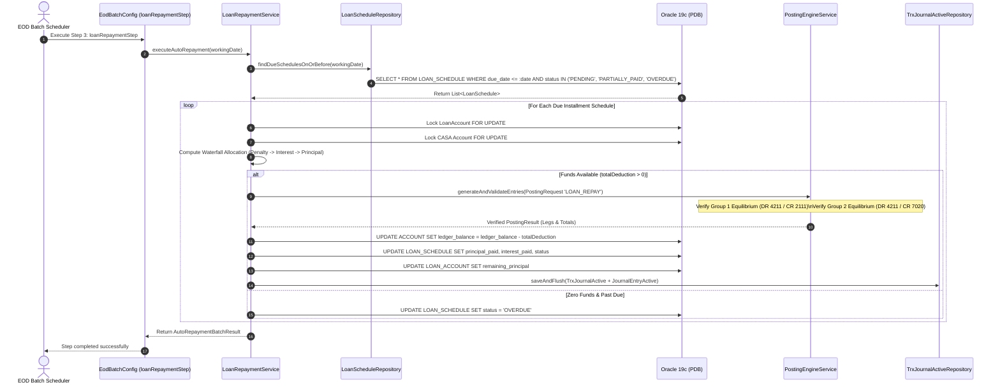
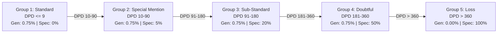

# 🌊 Waterfall Allocation & Loan Repayment Mechanism in Core Banking

## 1. Executive Summary & Regulatory Framework

In retail and commercial banking, loan repayment is rarely an ad-hoc manual activity. Rather, it is executed through an automated **End-of-Day (EOD) Batch Process** (`LoanRepaymentService`) that systematically sweeps funds from the borrower's linked CASA (Current & Savings Account) deposit account.

When a borrower has insufficient funds to satisfy the entire installment obligation, banking regulations strictly prohibit arbitrary fund distribution. Instead, Core Banking systems must execute a statutory **Waterfall Allocation Mechanism** (Priority-Based Debt Recovery).

### Statutory Precedence (SBV Circular 39/2016/TT-NHNN):
1. **Late Fees & Penalties** (`penalty_due`)
2. **Overdue Interest** (`overdue_interest_due`)
3. **In-Term / Accrued Interest Due** (`interest_due`)
4. **Overdue Principal** (`overdue_principal_due` — tracked under GL `2112`)
5. **In-Term Principal Due** (`principal_due` — tracked under GL `2111`)

> **Key Banking Principle**: Fees and interest must always be collected *before* principal recovery. This ensures that the bank's operational, penalty, and funding costs are covered first, preventing interest decapitalization and maintaining accurate Net Interest Margin (NIM) recognition.

---

## 2. Waterfall Deduction Flowchart

The following diagram illustrates the decision tree executed per loan schedule installment during the EOD batch run:

---

## 3. Component Interaction Sequence Diagram

The sequence diagram below displays the end-to-end component choreography between the Spring Batch pipeline, domain services, the posting engine, and the Oracle database:

---

## 4. Double-Entry Accounting Rule Matrix (`LOAN_REPAY`)

When the Waterfall Allocation calculates the deductible amounts, it generates a multi-group atomic voucher under transaction code `LOAN_REPAY`:

| Group | Leg | Abstract Account | Physical GL | Dr/Cr | Amount Source | Description |
| :---: | :---: | :--- | :---: | :---: | :--- | :--- |
| **1** | 1 | `CUSTOMER_ACCOUNT` | **4211** | **Debit** | `PRINCIPAL_AMOUNT` | Deduct loan principal recovery from borrower's CASA |
| **1** | 2 | `SYS_LOAN_PRINCIPAL` | **2111** | **Credit** | `PRINCIPAL_AMOUNT` | Reduce outstanding short-term loan principal asset |
| **2** | 1 | `CUSTOMER_ACCOUNT` | **4211** | **Debit** | `INTEREST_AMOUNT` | Deduct interest payment from borrower's CASA |
| **2** | 2 | `SYS_INT_REVENUE` | **7020** | **Credit** | `INTEREST_AMOUNT` | Recognize interest income on lending |

### Mathematical Equilibrium Guarantee:
$$\sum \text{Debit} = \text{Debit}_{4211}^{\text{principal}} + \text{Debit}_{4211}^{\text{interest}} \equiv \text{Credit}_{2111}^{\text{principal}} + \text{Credit}_{7020}^{\text{interest}} = \sum \text{Credit}$$

---

## 5. Concrete Numerical Scenarios

### Baseline Contract Parameters:
- **Loan Amount**: 12,000,000 VND
- **Installment Schedule #1**:
  - `principal_due`: 1,000,000 VND
  - `interest_due`: 100,000 VND
  - `penalty_due`: 0 VND
  - **Total Installment Obligation**: **1,100,000 VND**

---

### Scenario A: Full Repayment (Sufficient CASA Balance)
- **CASA Balance**: 10,000,000 VND
- **Waterfall Allocation**:
  1. Penalty paid: $0$ VND
  2. Interest paid: $100,000$ VND
  3. Principal paid: $1,000,000$ VND
  4. Total deduction: **1,100,000 VND**
- **Post-Transaction State**:
  - CASA Balance: $10,000,000 - 1,100,000 = \mathbf{8,900,000\text{ VND}}$
  - Schedule #1 Status: $\mathbf{PAID}$
  - Loan Remaining Principal: $12,000,000 - 1,000,000 = \mathbf{11,000,000\text{ VND}}$

---

### Scenario B: Partial Repayment (Waterfall Protection)
- **CASA Balance**: 250,000 VND (Insufficient to cover 1,100,000 VND)
- **Waterfall Allocation**:
  1. Penalty paid: $0$ VND
  2. Interest paid: $\min(100,000, 250,000) = \mathbf{100,000\text{ VND}}$ (Interest satisfied 100%)
  3. Available remaining: $250,000 - 100,000 = 150,000$ VND
  4. Principal paid: $\min(1,000,000, 150,000) = \mathbf{150,000\text{ VND}}$
  5. Total deduction: **250,000 VND**
- **Post-Transaction State**:
  - CASA Balance: $250,000 - 250,000 = \mathbf{0\text{ VND}}$
  - Schedule #1 Status: $\mathbf{PARTIALLY\_PAID}$ (Remaining due: $850,000$ VND principal)
  - Loan Remaining Principal: $12,000,000 - 150,000 = \mathbf{11,850,000\text{ VND}}$
  - *Accounting Result*: Bank successfully booked 100,000 VND into interest revenue (GL 7020) without suffering uncollected interest loss.

---

### Scenario C: Complete Default / Zero Balance
- **CASA Balance**: 0 VND
- **Waterfall Allocation**:
  1. Total deduction: **0 VND** (No journal entry posted)
- **Post-Transaction State**:
  - If $\text{due\_date} < \text{workingDate}$: Schedule #1 is transitioned to $\mathbf{OVERDUE}$.
  - In subsequent EOD step (`loanAgingStep`), the loan's DPD increases, triggering overdue transfer to GL `2112` and loan loss provisioning.

---

## 6. DPD Aging & Provisioning Integration

Following the repayment step, the EOD batch executes `loanAgingStep` ([`LoanAgingService.java`](../src/main/java/com/cbs/lending/service/LoanAgingService.java)) to assess loan health and provisioning according to Circular 11/2021/TT-NHNN:

### Statutory Provision Reversal on Payoff (`LOAN_PROVISION_RELEASE`):
When a loan is resolved or paid off (`remaining_principal == 0`), accumulated provisions are **never credited back to expense 88xx**. Instead, they are reversed into miscellaneous revenue:
$$\text{Debit (DR): } \mathbf{2191} \text{ / } \mathbf{2192} \text{ (General / Specific Provision Fund)}$$
$$\text{Credit (CR): } \mathbf{7911} \text{ (SYS\_PROV\_REVERSAL\_INCOME - Loan Loss Provision Reversal Revenue)}$$

---

## 7. Implementation Artifacts & Cross-References

- **Repayment Service**: [`LoanRepaymentService.java`](../src/main/java/com/cbs/lending/service/LoanRepaymentService.java)
- **Aging & Provisioning Service**: [`LoanAgingService.java`](../src/main/java/com/cbs/lending/service/LoanAgingService.java)
- **Batch Step Configuration**: [`EodBatchConfig.java`](../src/main/java/com/cbs/eod/config/EodBatchConfig.java)
- **Database Rules & Schema**: [`V10__seed_loan_repayment_rules.sql`](../src/main/resources/db/migration/V10__seed_loan_repayment_rules.sql)
- **Unit Verification**: [`LoanRepaymentServiceTest.java`](../src/test/java/com/cbs/lending/service/LoanRepaymentServiceTest.java) | [`LoanAgingServiceTest.java`](../src/test/java/com/cbs/lending/service/LoanAgingServiceTest.java)
- **End-to-End Integration**: [`EodLendingIntegrationTest.java`](../src/test/java/com/cbs/lending/EodLendingIntegrationTest.java)
